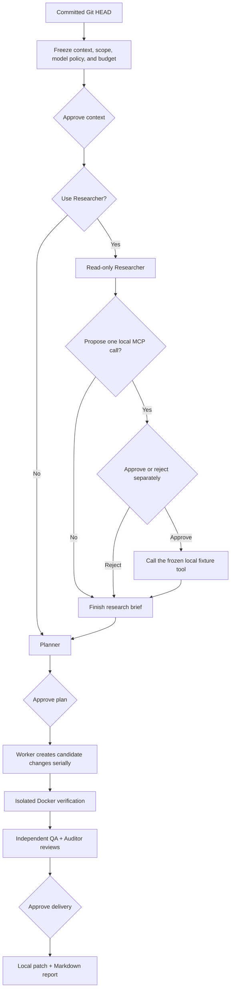

<div align="center">

# FOUNDRY

**Turn a committed Git snapshot into a reviewable, verifiable, locally deliverable patch.**

Experimental · Local-first · macOS arm64 source-alpha snapshot

[简体中文](README.md) · [English](README.en.md)

</div>

FOUNDRY is a workbench for local software delivery. It turns a committed Git snapshot into an inspectable plan, candidate changes, isolated verification evidence, and downloadable local patch and Markdown report artifacts.

FOUNDRY does not treat model output as authority. It does not modify the source repository, apply patches automatically, commit, push, deploy, or run database migrations. Context sharing, an optional single MCP call, plan execution, and final delivery require separate explicit approvals.

> [!CAUTION]
> This repository is the first public experimental source-alpha snapshot, not an installer, binary release, or production service. Only Apple Silicon Macs are supported. No real model account, subscription, quota, billing behavior, or external MCP service has been certified. Read [Alpha status](docs/public/alpha-status.md) and the [Safety model](docs/public/safety.md) before your first run.

## Workflow



Each approval authorizes one object in the graph and is bound to the current controller-computed revision and digest. Context approval does not authorize a tool call or execution. One MCP grant does not authorize a second call. Plan approval does not authorize delivery.

## Why it works this way

| Boundary | What it means for you |
| --- | --- |
| The deterministic controller holds authority | Model, MCP, Skill, repository, and browser content remain untrusted data. Only the controller advances state, validates evidence, and exports artifacts. |
| The source repository stays read-only | FOUNDRY reads a fixed commit and keeps candidates in its own data directory. Delivery exports a patch and report for human review. |
| Approval is layered | Context, a single MCP call, plan execution, and delivery do not imply one another. Changed inputs invalidate old approvals. |
| Verification is separate from review | Acceptance commands run in an existing trusted Docker image. QA and Auditor independently review the current candidate and actual evidence. |
| Uncertainty fails closed | An unknown remote outcome is not retried automatically, routed to another provider, refunded, or described as rolled back. |

## Current alpha boundary

| Implemented | Not implemented in this alpha |
| --- | --- |
| Go controller, React workbench, SQLite state, and real event streaming | Installer, signed application, package-manager distribution, or downloadable binary release |
| One Worker per mission with serial execution; multiple mission records may coexist | Multi-worker scheduling or autonomous background execution |
| Committed Git snapshots, protected paths, and controller-owned candidate generations | Source-repository writes, automatic apply, commit, push, release, or deployment |
| Bounded repository reads, static Skill text, and MCP catalog discovery | Skill or script execution, generic external MCP `tools/call`, webhooks, or Git hooks |
| Offline acceptance in an already-present Docker image | Automatic image pulls, host-shell fallback, package building, or database migration |
| QA/Auditor review followed by local patch and report export | Automatic provider or paid fallback, replay of unknown remote outcomes, or real-account certification |

“Not implemented” is not a delivery promise. See [Alpha status](docs/public/alpha-status.md) for the complete release-readiness boundary.

## Roles

| Role | Current responsibility | Hard boundary |
| --- | --- | --- |
| Main | Explains goals, plans, evidence, and blockers | Chat text cannot approve execution or delivery |
| Researcher | Optionally inspects repository facts read-only and cites real paths | Cannot execute code, expand authority, or browse the web |
| Planner | Produces an acyclic plan of at most six steps | Cannot approve or execute its own plan |
| Worker | Proposes complete file contents one plan step at a time | Limited to exact step files; no host shell or source-repository writes |
| Debugger | Proposes bounded repairs from failure evidence | At most two rounds; cannot delete tests or weaken acceptance criteria |
| QA | Reviews the current candidate and deterministic verification evidence | Cannot invent test results; insufficient evidence must fail |
| Auditor | Independently reviews changes, scope, safety, and evidence | Cannot write code or self-authorize delivery; may block delivery |

Role separation is not permission separation. The controller enforces every permission.

## Safe start in three steps

### Prerequisites

- An Apple Silicon Mac (`darwin/arm64`) with cgo enabled and a working C compiler. The supported credential backend is macOS Keychain.
- Go 1.27, Node.js, npm, and the system `/usr/bin/git` with `GIT_NO_LAZY_FETCH` support. `/usr/bin/git --no-lazy-fetch --version` must succeed; installing another Git on `PATH` does not replace this trusted path. The current alpha validation toolchain is Go 1.27.2, Node.js 22.23.2, and npm 10.9.8.
- Docker is required only for task execution, verification, or Docker smoke tests. Its daemon must already be running and the exact trusted image must already exist locally. FOUNDRY uses `--pull=never`.

### 1. Install locked frontend dependencies and build

```sh
git clone https://github.com/tsumon/foundry.git
cd foundry
cd web
npm ci
cd ..
./scripts/build.sh
```

The build script runs the TypeScript/Vite production build and creates `./bin/foundry`. It does not install Go, Node.js, npm, Docker, or images.

### 2. Create a fresh private data directory

```sh
FOUNDRY_ALPHA_DATA="$(mktemp -d)"
chmod 700 "$FOUNDRY_ALPHA_DATA"
export FOUNDRY_DATA_DIR="$FOUNDRY_ALPHA_DATA"
```

Do not point a first alpha run at an existing FOUNDRY data directory. Startup takes an exclusive directory lock and may perform local recovery or cleanup for recorded work.

### 3. Start the workbench

```sh
./bin/foundry
```

Open <http://127.0.0.1:4317>. The server accepts only the literal address `127.0.0.1:<port>`. Wildcard addresses, `localhost`, and other loopback addresses are rejected.

This empty first start does not create a model profile, read provider credentials, start a model fixture, pull a Docker image, or contact a provider.

### Troubleshooting

- **The default port is busy:** choose another literal loopback port, such as `FOUNDRY_ADDR=127.0.0.1:4318 ./bin/foundry`, then open <http://127.0.0.1:4318>.
- **The build preflight fails:** use `scripts/verify.sh` as the version reference for Go 1.27.2, Node.js 22.23.2, npm 10.9.8, cgo/a C compiler, and `/usr/bin/git --no-lazy-fetch --version`. `scripts/build.sh` does not install missing tools or frontend dependencies.
- **The data directory is already owned:** stop the other FOUNDRY process that owns it, or create a new temporary directory for alpha evaluation. Do not force-delete the lock, database, workspaces, or sealed evidence to bypass state checks.

## Local development entrypoints

| Entry point | Behavior |
| --- | --- |
| `./scripts/start.sh` | Rebuilds the frontend and backend, then starts `./bin/foundry`. |
| `./scripts/dev.sh` | Rebuilds, watches frontend changes, and runs the same Go server. Restart it for Go changes. |
| `go run ./cmd/foundry-acceptance --web-dir web/dist` | Starts a synthetic acceptance environment with disposable state, fake in-memory credentials, and local protocol fixtures. It is not the production entrypoint and does not validate a real account. |

The production entrypoint can explicitly start its controller-owned synthetic MCP test service:

```sh
FOUNDRY_MCP_DATA="$(mktemp -d)"
FOUNDRY_DATA_DIR="$FOUNDRY_MCP_DATA" ./bin/foundry --local-mcp-test
```

The service exposes one fixed read-only test tool and is the only MCP eligible for task-time `tools/call` in this alpha. It does not provide a model fixture or model profile. Planning still needs a separately configured model and every normal approval gate.

<details>
<summary>Runtime settings</summary>

| Setting | Default and behavior |
| --- | --- |
| `FOUNDRY_DATA_DIR` | Database, controller lock, mission workspaces, and exports. Defaults to `foundry` under the operating-system user configuration directory. An explicit empty value is rejected. |
| `FOUNDRY_ADDR` | `127.0.0.1:4317`. Only literal `127.0.0.1` with a valid port is accepted. |
| `FOUNDRY_WEB_DIR` | Defaults to `web/dist` when that directory exists. An explicit empty value disables static UI serving. |
| `FOUNDRY_DOCKER` | Docker executable name or path. Defaults to `docker`. |
| `FOUNDRY_DISABLE_CONTROLLED_READ_CREATION` | Optional Go boolean. `true` prevents new controlled-read tasks while historical records remain readable. Malformed values stop startup. |
| `FOUNDRY_GO` | Go command used by `scripts/build.sh` and the Makefile. Defaults to `go`. |
| `--local-mcp-test` | The only supported application flag. The synthetic MCP fixture is off by default. |

</details>

## Important safety boundaries

- **FOUNDRY is not entirely offline.** New account routes marked `live` fail closed with `live_provider_access_pending_confirmation`, but compatible legacy accountless profiles can still contact their configured HTTPS provider during an approved model operation. Local providers may use literal-loopback HTTP. Explicitly approved MCP catalog discovery can also contact the selected endpoint.
- **Do not evaluate the alpha with real credentials.** Synthetic tests do not certify a real API key, account, subscription, entitlement, quota, billing, balance, or reset time. Production credentials are designed for macOS Keychain, not SQLite, browser storage, logs, reports, or fixtures.
- **Docker isolation is not a security proof.** FOUNDRY uses an existing image, `--pull=never`, `--network=none`, a read-only candidate mount, an unprivileged user, and resource limits. These controls do not prove the image, Docker, the host kernel, the command, or candidate code safe.
- **Use disposable inputs.** Evaluate the alpha with a disposable Git repository containing no secrets and a fresh data directory. Do not expose the loopback service through a proxy or port forward. Review every exported patch outside the product before applying it.

## Documentation

- [Alpha status](docs/public/alpha-status.md): implemented behavior, exclusions, support boundary, and release readiness
- [Architecture](docs/public/architecture.md): components, approval graph, immutable snapshots, failure, and recovery
- [Safety model](docs/public/safety.md): credentials, MCP, Docker, and alpha operating rules
- [Contributing](CONTRIBUTING.md) · [Changelog](CHANGELOG.md) · [Security reporting](SECURITY.md) · [Apache License 2.0](LICENSE)

Report security issues through [GitHub private vulnerability reporting](https://github.com/tsumon/foundry/security/advisories/new), not a public issue.

---

Copyright © 2026 [tsumon](https://github.com/tsumon). Source is licensed under the [Apache License 2.0](LICENSE).
