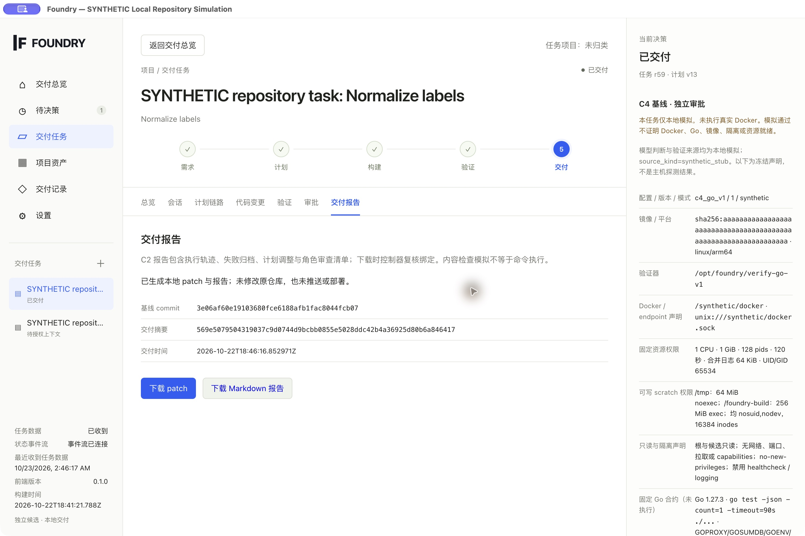

<div align="center">


# FOUNDRY

### A clear delivery process—even when the team is just you.

Plans · Isolated candidates · Built-in sandbox · Repairs · Approvals · Local patches

[](https://github.com/tsumon/foundry/actions/workflows/verify.yml)
[](https://github.com/tsumon/foundry/actions/workflows/desktop.yml)
[](https://github.com/tsumon/foundry/releases/tag/v0.1.0)
[](LICENSE)

[简体中文](README.md) · [English](README.en.md) · [Install & use](docs/public/desktop-guide.md) · [Architecture](docs/public/architecture.md) · [Safety](docs/public/safety.md)

[](https://github.com/tsumon/foundry/releases/download/v0.1.0/Foundry-0.1.0-arm64.dmg)
[](https://github.com/tsumon/foundry/releases/download/v0.1.0/Foundry-0.1.0-x64.exe)

[v0.1.0 · Release notes & all files](https://github.com/tsumon/foundry/releases/tag/v0.1.0) · [SHA-256 checksums](https://github.com/tsumon/foundry/releases/download/v0.1.0/SHA256SUMS)

</div>

<p align="center"></p>
<p align="center"><sub>Actual workbench with disposable synthetic data. A screenshot is not evidence of model or sandbox execution.</sub></p>

Foundry is a **Go software-delivery workbench** for a one-person team. Connect an explicitly chosen API model, start from a committed Git snapshot, plan changes, edit isolated candidates, test in a bundled VM, repair confirmed failures and deliver a reviewable **patch and Markdown report**. Your source repository stays untouched; applying and deploying the patch remain your decisions.

> [!IMPORTANT]
> **Stable 0.1.0 supports serial delivery for standard-library Go projects.** It does not promise arbitrary languages, unattended development or automatic deployment. The default sandbox ships with the app and needs no Docker Desktop. If virtualization is unavailable, execution stops; it never falls back to the host. API models are the recommended path; ChatGPT subscription sign-in remains experimental.

## One workbench, three connected views

| Understand the plan | Verify the changes | Keep the evidence |
| :--- | :--- | :--- |
| Researcher investigates and Planner proposes. Context sharing and plan execution have separate approvals; plans are editable. | Worker builds an isolated candidate. Protected tests run in a real VM. Confirmed failures can enter at most two Debugger rounds. | QA and Auditor review the same candidate and test evidence. Export requires separate approval; failures and spent calls remain recorded. |

## Download and install

| Platform | Installer | Corresponding third-party source |
| :--- | :--- | :--- |
| Apple Silicon Mac | [Foundry-0.1.0-arm64.dmg](https://github.com/tsumon/foundry/releases/download/v0.1.0/Foundry-0.1.0-arm64.dmg) | [Runtime and sandbox source](https://github.com/tsumon/foundry/releases/download/v0.1.0/Foundry-0.1.0-macos-sources.tar.gz) |
| Windows x64 | [Foundry-0.1.0-x64.exe](https://github.com/tsumon/foundry/releases/download/v0.1.0/Foundry-0.1.0-x64.exe) | [Runtime and sandbox source](https://github.com/tsumon/foundry/releases/download/v0.1.0/Foundry-0.1.0-windows-sources.tar.gz) |

Check [SHA256SUMS](https://github.com/tsumon/foundry/releases/download/v0.1.0/SHA256SUMS) after downloading. The [Release](https://github.com/tsumon/foundry/releases/tag/v0.1.0) retains the exact commit, installation/upgrade acceptance, real-call scope, clean source and third-party materials. These are fixed versioned files, not rolling builds of main.

**Signing status:** Mac uses an ad-hoc integrity signature, without Developer ID signing or notarization. Windows is unsigned, with no verified publisher. Checksums do not authenticate the publisher. Do not disable Gatekeeper, SmartScreen or antivirus; use the reviewed source workflow if your organization's policy rejects unsigned apps. A stable version number does not mean platform notarization or a commercial support promise.

The controller, frontend, Linux guest and Go toolchain are bundled. You do not need separate Go, Node.js, npm or Docker installations. Repository imports require supported local Git. Windows also requires hardware virtualization and Windows Hypervisor Platform already enabled. Foundry does not enable OS features, install services or reboot the machine. Intel Mac, Windows ARM and Linux desktop packages are not supported. See the [desktop guide](docs/public/desktop-guide.md).

## Deliver with your own model

Choose **Controlled Coding Workbench** in the app menu:

1. **Configure an API.** Create an OpenAI or compatible Responses-gateway API Key account and save its key. Use **API quick setup** to enter an available model ID, acknowledge billing and assign it to roles for new tasks. Explicit Magpie/CPA Responses endpoints are supported. No ChatGPT login is needed; saving does not query a catalog or run inference. [Setup guide](docs/public/api-key-coding.md)
2. **Import a repository.** Choose a committed standard-library Go repository, describe the goal, specify editable files and protected tests, and confirm models, the call ceiling and sandbox.
3. **Establish the baseline.** Separately approve and run VM readiness and baseline tests. The baseline must pass; this workflow does not ask the model to repair an already-failing repository.
4. **Approve the plan.** Confirm the outgoing files and receiver, authorize Researcher / Planner, then review or revise their plan before separately approving execution.
5. **Check the outcome.** Worker edits an isolated candidate. Confirmed test failures trigger bounded Debugger repair and recheck. QA / Auditor independently review the evidence. Network, infrastructure and unknown-outcome failures stop.
6. **Deliver.** Approve patch/report export and review/apply it outside the product. Foundry does not automatically commit, push, deploy or edit the source repository.

API keys live in macOS Keychain or Windows Credential Manager, not browser storage or plaintext configuration. Tasks pin the receiver, account and model, with no automatic call retry or paid-provider fallback. Call counts and timeouts **are not monetary caps**; also configure provider spending limits. A dispatched call with an unknown result still consumes budget and is never replayed on restart.

Tests run in a Linux guest; they do not certify native DMG, EXE, web or mobile apps. The guest has no network or host share and installs no external dependencies. Mac users with an existing Docker setup may explicitly choose an immutable local image for a new task, with separate approvals; Docker is never an automatic VM fallback.

## Read the evidence by scope

| Evidence | What it covers |
| :--- | :--- |
| [Real Mac CPA/Grok delivery](docs/public/compatible-api-acceptance.md) | Five real role calls; baseline and candidate each passed 14 real VM tests, with source and protected tests unchanged. The first candidate passed, so no real Debugger call occurred. |
| [Real repair delivery](docs/public/compatible-api-acceptance.md#real-repair-and-delivery--stable-candidate) | Six roles each called the real model once. A deliberate injected error failed in the VM; Debugger repaired it and all 9 tests passed. This is not a claim of a spontaneous model defect. |
| Versioned Release receipts | Distinguish provider calls, protocol fixtures, installation/upgrade and VM execution, bound to commits and installer hashes. |
| Native Windows installation and WHPX acceptance | Actual installation, UI, restart and VM failure→repair→recheck. Protocol-fixture roles are not real Windows provider calls. |
| Local demonstration | Labeled `SYNTHETIC` / `synthetic_stub`; no cloud calls or Go compiler execution. |

Historical OpenAI subscription response failures remain recorded; success on the API/Grok route does not rewrite them. Each live acceptance proves only its receiver, model, project and host. See [supported scope](docs/public/alpha-status.md).

## Upgrade and recover

Upgrading does not reset consumed budgets or rewrite historical baselines and evidence. Existing tasks select their retained sandbox by its complete frozen identity; new tasks use the current default. Missing or damaged old assets block execution rather than selecting a replacement. Uninstall preserves task data. Back up before upgrading; recover from a consistent backup instead of pointing an older program at upgraded data.

Subscription login, catalog discovery and standing renewal remain independent experimental permissions; API quick setup requires none of them. Historical subscription tasks are never silently migrated to a paid API. See [upgrade compatibility](docs/public/desktop-parity-upgrade.md) and [session renewal](docs/public/session-renewal.md).

## Try the workflow without an account

Choose **Foundry → New Isolated Local Repository Simulation**, open a `SYNTHETIC` task and follow baseline → context → plan → edit/failure repair → delivery approvals. Each demonstration has independent inputs and a database; evidence survives exit. **Persistent Workbench** separately manages projects, delivery targets, environments, shared resources and task links, without mixing in demo data.

MCP, Skills and observation hooks provide management, discovery and static descriptions. The desktop does not allow arbitrary external tools or scripts. Database migration, deployment, automatic apply and Git writes are outside this version's scope.

## Run from source

Development baseline: Go **1.27.3**, Node.js **22.23.2**, npm **10.9.8**, cgo/a C compiler and supported local Git.

```sh
git clone --branch v0.1.0 --depth 1 https://github.com/tsumon/foundry.git
cd foundry
npm ci --prefix web
./scripts/build.sh
go run ./cmd/foundry-acceptance --repository-tasks-fixture --web-dir web/dist
```

Open the printed random loopback URL. This example uses disposable data and local simulation, without reading real credentials. Other CLI operator modes have their own configured capabilities.

| Using Foundry | Engineering & safety |
| :--- | :--- |
| [Install, demonstrate, troubleshoot](docs/public/desktop-guide.md) | [Architecture and approvals](docs/public/architecture.md) |
| [API setup and call boundaries](docs/public/api-key-coding.md) | [Safety model](docs/public/safety.md) |
| [Version capabilities and limits](docs/public/alpha-status.md) | [Third-party notices](THIRD_PARTY_NOTICES.md) |
| [Changelog](CHANGELOG.md) | [Development and contributions](CONTRIBUTING.md) |

Report vulnerabilities through [GitHub private vulnerability reporting](https://github.com/tsumon/foundry/security/advisories/new), never by publishing credentials.

---

Copyright © 2026 [tsumon](https://github.com/tsumon). Foundry source is [Apache-2.0](LICENSE), permitting commercial use under its terms. Linux, QEMU, Electron and other third-party components retain their own licenses; redistribute corresponding source and notices with the installers. No commercial support or service-level commitment is offered.
