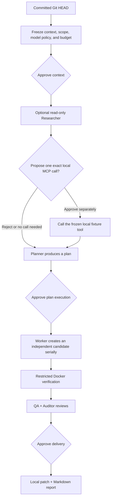

<div align="center">

# FOUNDRY

**Turn a committed Git snapshot into a reviewable, verifiable, locally deliverable patch.**

Experimental · Local-first · macOS arm64 source alpha

[](https://github.com/tsumon/foundry/actions/workflows/verify.yml)
[](docs/public/alpha-status.md)
[](docs/public/alpha-status.md)
[](LICENSE)

[简体中文](README.md) · [English](README.en.md) · [Get started](#quick-start) · [Safety](docs/public/safety.md) · [Architecture](docs/public/architecture.md)

</div>

> [!CAUTION]
> This is an experimental source alpha, not an installer, binary release, or production service. Only Apple Silicon Macs are currently supported. No real model account, subscription, quota, billing behavior, or external MCP service has been certified. Use only a disposable repository without secrets, a fresh private data directory, and synthetic model configuration.

<p align="center">
  
</p>

<p align="center"><sub>Actual workbench UI, shown in Chinese, backed by a disposable synthetic repository, fake in-memory credentials, local protocol fixtures, and a synthetic runner. This image is not evidence of a real account, cloud provider, external MCP, or Docker execution.</sub></p>

FOUNDRY is a workbench for local software delivery. It freezes a committed Git snapshot, turns model suggestions into an inspectable plan and independent candidate, and places verification evidence, QA/Auditor review, and final export behind separate approval gates.

It does not treat model output as authority. It does not modify the source repository, apply patches automatically, commit, push, deploy, or run database migrations. The final artifacts are a local patch and Markdown report for another human review.

## Three outcomes

| Inspect first, then approve | Keep the source repository read-only | Stop when evidence is insufficient |
| --- | --- | --- |
| Context sharing, one MCP call, plan execution, and final delivery require separate approvals. Each approval binds a controller-computed revision and digest. | FOUNDRY reads a fixed commit and keeps candidates under its controller data directory. Workers do not run a host shell or write directly to the source repository. | Verification and QA/Auditor review are separate. An unknown remote outcome is not retried, routed to another provider, refunded, or described as rolled back. |

<a id="quick-start"></a>

## Safe start in three steps

### Prerequisites

- An Apple Silicon Mac (`darwin/arm64`) with cgo enabled and a working C compiler. The supported credential backend is macOS Keychain.
- Go 1.27.3, Node.js 22.23.2, npm 10.9.8, and the system `/usr/bin/git` with `GIT_NO_LAZY_FETCH` support. `/usr/bin/git --no-lazy-fetch --version` must succeed; another Git on `PATH` does not replace this trusted path.
- Docker is required only for task execution, verification, or Docker smoke tests. Its daemon must already be running and the exact trusted image must already exist locally. FOUNDRY uses `--pull=never`.

### 1. Install locked frontend dependencies and build

```sh
git clone https://github.com/tsumon/foundry.git
cd foundry
cd web
npm ci
cd ..
./scripts/build.sh
```

The build script runs the TypeScript/Vite production build and creates `./bin/foundry`. It does not install Go, Node.js, npm, Docker, or images.

### 2. Create a fresh private data directory

```sh
FOUNDRY_ALPHA_DATA="$(mktemp -d)"
chmod 700 "$FOUNDRY_ALPHA_DATA"
export FOUNDRY_DATA_DIR="$FOUNDRY_ALPHA_DATA"
```

Do not point a first run at an existing FOUNDRY data directory. Startup takes an exclusive directory lock and may perform local recovery or cleanup for recorded work.

### 3. Start the workbench

```sh
./bin/foundry
```

Open <http://127.0.0.1:4317>. The server accepts only the literal address `127.0.0.1:<port>`. Wildcard addresses, `localhost`, and other loopback addresses are rejected. This empty first start does not create a model profile, read provider credentials, start a model fixture, pull a Docker image, or contact a provider.

<details>
<summary>Startup troubleshooting</summary>

- **The default port is busy:** use another literal loopback port, such as `FOUNDRY_ADDR=127.0.0.1:4318 ./bin/foundry`, then open <http://127.0.0.1:4318>.
- **The build preflight fails:** use `scripts/verify.sh` to check the exact tool versions, cgo/a C compiler, and `/usr/bin/git --no-lazy-fetch --version`. `scripts/build.sh` does not install missing tools or frontend dependencies.
- **The data directory is already owned:** stop the other FOUNDRY process that owns it, or create a new temporary directory. Do not force-delete the lock, database, workspaces, or sealed evidence to bypass state checks.

</details>

## Workflow and alpha boundary



Context approval does not authorize a tool call or execution. One MCP grant does not authorize a second call. Plan approval does not authorize delivery. Roles divide responsibilities; they do not grant permission. See [Architecture](docs/public/architecture.md) for the full approval graph and role boundaries.

| Implemented in this alpha | Not implemented in this alpha |
| --- | --- |
| Go controller, React workbench, SQLite state, and real event streaming | Installer, signed application, package-manager distribution, or downloadable binary release |
| One Worker per mission with serial execution; multiple mission records may coexist | Multi-worker scheduling or autonomous background execution |
| Committed Git snapshots, protected paths, and controller-owned candidate generations | Source-repository writes, automatic apply, commit, push, release, or deployment |
| Bounded repository reads, static Skill text, and MCP catalog discovery | Skill or script execution, generic external MCP `tools/call`, webhooks, or Git hooks |
| Offline acceptance in an already-present Docker image | Automatic image pulls, host-shell fallback, package building, or database migration |
| Local account/route metadata acceptance inspection with live access closed | Real-account, subscription, quota, billing, catalog, or inference certification |
| QA/Auditor review followed by local patch and report export | Automatic provider or paid fallback, or replay of unknown remote outcomes |

“Not implemented” is not a delivery promise. See [Alpha status](docs/public/alpha-status.md) for the complete readiness and verification boundary.

## Synthetic acceptance workbench

After building the frontend, start a disposable acceptance environment to inspect actual workbench states without reading personal configuration or contacting a real provider:

```sh
go run ./cmd/foundry-acceptance --web-dir web/dist
```

The command creates a fresh temporary Git repository and SQLite state, then uses fake in-memory credentials, controller-owned literal-`127.0.0.1` protocol fixtures, a random non-production port, and a synthetic runner. It is not the production entrypoint. The runner does not execute Docker, and temporary artifacts are retained after shutdown for inspection.

<p align="center">
  
</p>

<p align="center"><sub>The current UI is shown in Chinese. The read-only local metadata inspection reports blocked phases, route configuration, and unknown remote state. It does not read Keychain values, contact a provider, or authorize login, catalog discovery, inference, or task execution.</sub></p>

Model access follows a “prepare first, approve each later stage” design. In addition to read-only local metadata inspection, the disposable acceptance environment now provides three separately proposed, approved, and explicitly executed local synthetic gates for connection, catalog, and inference. They contact only process-owned loopback fixtures. Real sign-in, real catalog discovery, real inference, and task acceptance remain separately closed. See [Model acceptance: preparation, not live access](docs/public/model-acceptance.md).

A separate browser-connection simulation supports explicit execution after approval, a ten-minute human-login window, manual status reads and cancellation, with one-attempt and failure-recovery evidence. It does not enable real sign-in or a native Keychain check. See [connection approval handoff and human-login lifetime](docs/public/openai-connection-handoff.md).

The OpenAI subscription [operator entry](docs/public/openai-operator-entry.md) is wired but ordinary startup remains closed. After separate confirmation, an operator must explicitly bind one official route and complete a new native test-item Keychain probe in that process. The workbench still requires separate proposal, approval, execution and manual browser handoff. Public implementation validation uses local simulations; connection mode does not enable catalog, inference, refresh, automatic retry or paid-API fallback.

The [independent catalog gate](docs/public/openai-catalog-gate.md) is separate from connection approval. A dedicated operator mode can prepare one fixed `GET /v1/models` request for the current unexpired subscription authorization, followed by separate approval and explicit execution. Ordinary startup stays closed. Expired credentials stop the flow, with no refresh, retry, inference or automatic role-policy changes. Validation uses local simulation only; a returned catalog does not certify inference, quota or billing.

The [independent single-inference gate](docs/public/openai-inference-gate.md) is also default-closed. A dedicated operator mode can prepare one fixed-text `gpt-6.1-sol` test backed by current connection and same-credential catalog evidence, with separate approval and explicit execution. It cannot authorize task inference or another model. The 30-second timeout and 1 MiB receive limit are not token or monetary caps. Quota and remote billing remain unknown; failure or expiry stops without refresh, retry or paid-API fallback. Implementation validation uses local simulation only; real inference requires separate confirmation.

<details>
<summary>Local development and runtime entrypoints</summary>

| Entry point | Behavior |
| --- | --- |
| `./scripts/start.sh` | Rebuilds the frontend and backend, then starts `./bin/foundry`. |
| `./scripts/dev.sh` | Rebuilds, watches frontend changes, and runs the same Go service. Restart it for Go changes. |
| `go run ./cmd/foundry-acceptance --web-dir web/dist` | Starts a disposable synthetic acceptance environment. It does not validate a real account, cloud provider, or Docker. |

The production entrypoint can explicitly start its controller-owned synthetic MCP test service:

```sh
FOUNDRY_MCP_DATA="$(mktemp -d)"
FOUNDRY_DATA_DIR="$FOUNDRY_MCP_DATA" ./bin/foundry --local-mcp-test
```

The service exposes one fixed read-only test tool and is the only MCP eligible for task-time `tools/call` in this alpha. It does not provide a model fixture or model profile. Planning still needs a separately configured model and every normal approval gate.

</details>

<details>
<summary>Runtime settings</summary>

| Setting | Default and behavior |
| --- | --- |
| `FOUNDRY_DATA_DIR` | Database, controller lock, task workspaces, and exports. Defaults to `foundry` under the operating-system user configuration directory. An explicit empty value is rejected. |
| `FOUNDRY_ADDR` | `127.0.0.1:4317`. Only literal `127.0.0.1` with a valid port is accepted. |
| `FOUNDRY_WEB_DIR` | Defaults to `web/dist` when that directory exists. An explicit empty value disables static UI serving. |
| `FOUNDRY_DOCKER` | Docker executable name or path. Defaults to `docker`. |
| `FOUNDRY_DISABLE_CONTROLLED_READ_CREATION` | Optional Go boolean. `true` prevents new controlled-read tasks while historical records remain readable. Malformed values stop startup. |
| `FOUNDRY_GO` | Go command used by `scripts/build.sh` and the Makefile. Defaults to `go`. |
| `--local-mcp-test` | Explicitly starts the synthetic MCP fixture; off by default. |
| `--openai-subscription-route` + `--openai-keychain-journal` | Paired operator opt-in for one existing official subscription route and a new private diagnostic journal. Runs a fresh native test-item probe; real use requires separate confirmation and never replaces one-operation workbench approval. See [operator entry](docs/public/openai-operator-entry.md). |
| `--openai-catalog-route` | Separate catalog mode, mutually exclusive with connection startup options. Startup inspects local route metadata only; preparation/approval do not read tokens or contact a provider. One real GET still requires independent approval and explicit execution. See [catalog gate](docs/public/openai-catalog-gate.md). |
| `--openai-inference-route` | Separate single-inference mode, mutually exclusive with connection/catalog options. Off by default; startup, preparation and approval inspect metadata only. One fixed-model, fixed-text request still requires independent approval and explicit execution, without automatic refresh, retry or paid-API fallback. See [inference gate](docs/public/openai-inference-gate.md). |

</details>

## Local repository-task demo (accountless simulation)

With the documented Go toolchain, cached dependencies and an already built
`web/dist`, run from the source root:

```sh
GOTOOLCHAIN=local GOPROXY=off GOSUMDB=off go run ./cmd/foundry-acceptance --repository-tasks-fixture --web-dir web/dist
```

Open the printed loopback URL. Two new disposable repositories demonstrate nested
label formatting and dependent multifile pricing changes, including a new file.
Separately approve and execute baseline, approve context/planning, review or edit
the plan, approve execution, inspect failure → repair → independent reviews, then
explicitly deliver the patch. Source files and source Git state remain unchanged.

Optionally add `--repository-task-path /absolute/path/to/repository` for a read-only
committed-HEAD import. Uncommitted/untracked files are ignored; the working
descriptor must match the commit. No worktree-cleanliness certification or Git
conversion filter runs. Protected `foundry.task.json` supplies proposals and exact
content assertions: **not autonomous reasoning or real Go/Docker tests**. This mode
constructs no account, Keychain, router or MCP service and cannot be combined with
`--c4-controls-fixture`. See the [contract and limits](docs/public/repository-task-orchestration.md).

A separately approved, bounded Double-project C4-C Docker acceptance was completed
earlier; its roles remained local simulations. That historical evidence grants no
authority for this demo or future real execution.

## Safety before first use

- **FOUNDRY is not entirely offline.** New account routes marked `live` fail closed with `live_provider_access_pending_confirmation`, but compatible legacy accountless profiles can still contact their configured HTTPS provider during an approved model operation. Local providers may use literal-loopback HTTP. Explicitly approved MCP catalog discovery can also contact the selected endpoint.
- **Do not evaluate the alpha with real credentials.** Local acceptance inspection and synthetic tests do not certify a real API key, account, subscription, entitlement, quota, billing, balance, or reset time. Production credentials are designed for macOS Keychain, not SQLite, browser storage, logs, reports, or fixtures.
- **Docker isolation is not a security proof.** FOUNDRY uses an existing image, `--pull=never`, `--network=none`, a read-only candidate mount, an unprivileged user, and resource limits. These controls do not prove the image, Docker, the host kernel, the command, or candidate code safe.
- **Use disposable inputs.** Do not expose the loopback service through a proxy or port forward. Review every exported patch outside the product before applying it.

## Documentation

- [Alpha status](docs/public/alpha-status.md): implemented behavior, exclusions, support boundary, and release readiness
- [Architecture](docs/public/architecture.md): components, approval graph, roles, immutable snapshots, failure, and recovery
- [Safety model](docs/public/safety.md): credentials, MCP, Docker, and alpha operating rules
- [Model acceptance](docs/public/model-acceptance.md): read-only preparation inspection, future stages, billing evidence, and failure matrix
- [Contributing](CONTRIBUTING.md) · [Changelog](CHANGELOG.md) · [Security reporting](SECURITY.md) · [Apache License 2.0](LICENSE)

Report security issues through [GitHub private vulnerability reporting](https://github.com/tsumon/foundry/security/advisories/new), not a public issue.

---

Copyright © 2026 [tsumon](https://github.com/tsumon). Source is licensed under the [Apache License 2.0](LICENSE).
