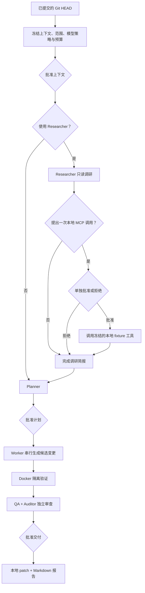

<div align="center">

# FOUNDRY

**把已提交的 Git 快照，变成可审、可验、可交付的本地补丁。**

实验性 · 本地优先 · macOS arm64 源代码 Alpha 快照

[简体中文](README.md) · [English](README.en.md)

</div>

FOUNDRY 是一个面向本地软件交付的工作台。它把已提交的 Git 快照转化为可检查的计划、候选变更、隔离验证证据，以及可下载的本地 patch 和 Markdown 报告。

FOUNDRY 不会把模型输出当作权限，也不会修改源仓库、自动应用 patch、提交、推送、部署或执行数据库迁移。上下文共享、可选的单次 MCP 调用、计划执行和最终交付分别需要明确批准。

> [!CAUTION]
> 当前仓库是首个公开的实验性源代码 Alpha 快照，不是安装包、二进制 Release 或生产服务。仅支持 Apple Silicon Mac；尚未用真实模型账户、订阅、额度、计费或外部 MCP 服务完成认证。首次使用前请阅读 [Alpha 状态](docs/public/alpha-status.md) 和 [安全模型](docs/public/safety.md)。

## 工作流



每次批准只授权图中的一个对象，并绑定控制器计算的当前 revision 和 digest。批准上下文不等于批准工具调用或执行；一次 MCP 授权不允许第二次调用；计划批准也不等于交付批准。

## 为什么这样设计

| 核心边界 | 对使用者的意义 |
| --- | --- |
| 确定性控制器掌权 | 模型、MCP、Skill、仓库内容和浏览器输入都被视为不可信数据；只有控制器能推进状态、校验证据和导出交付物。 |
| 源仓库只读 | FOUNDRY 读取固定 commit，候选文件保存在控制器数据目录中；最终只导出供人工检查的 patch 和报告。 |
| 授权分层 | 上下文、单次 MCP、计划执行和交付互不隐含，输入变化会使旧批准失效。 |
| 验证与审查分离 | 验收命令在已有的可信 Docker 镜像中运行；QA 和 Auditor 独立检查当前候选与实际证据。 |
| 不确定性关闭 | 远程结果未知时不会自动重试、替换 provider、退还预算或假装回滚成功。 |

## 当前 Alpha 边界

| 已实现 | 当前未实现 |
| --- | --- |
| Go 控制器、React 工作台、SQLite 状态和真实事件流 | 安装包、签名应用、包管理器分发或可下载二进制版本 |
| 每个任务内单 Worker、串行执行；可保存多个任务记录 | 多 Worker 调度或自主后台执行 |
| 已提交 Git 快照、受保护路径和控制器管理的候选代次 | 写入源仓库、自动 apply、commit、push、release 或 deploy |
| 受限的仓库读取、静态 Skill 文本和 MCP 目录发现 | Skill/脚本执行、通用外部 MCP `tools/call`、webhook 或 Git hook |
| 已有 Docker 镜像中的无网络验收 | 自动拉取镜像、主机 shell 回退、构建安装包或运行数据库迁移 |
| 验证后由 QA/Auditor 审查，再导出本地 patch 和报告 | 自动 provider/付费回退、未知远程结果重放或真实账户认证 |

“当前未实现”不代表交付承诺。完整的发布准备状态见 [Alpha 状态](docs/public/alpha-status.md)。

## 角色

| 角色 | 当前职责 | 不能越过的边界 |
| --- | --- | --- |
| Main | 解释目标、计划、证据和阻塞 | 对话文字不能批准执行或交付 |
| Researcher | 可选地只读调研仓库事实，并引用真实路径 | 不执行代码、不扩权、无外部网页研究 |
| Planner | 生成最多 6 步的有向无环计划 | 不自行批准或直接执行 |
| Worker | 按计划逐步提出完整文件内容 | 仅限当前步骤文件；不运行主机 shell、不写源仓库 |
| Debugger | 根据失败证据提出受限修复 | 最多 2 轮；不能删除测试或降低验收标准 |
| QA | 检查当前候选和确定性验证证据 | 不能编造测试结果；证据不足必须失败 |
| Auditor | 独立评估变更、范围、安全和证据 | 不能写代码或自授交付权限；可以阻止交付 |

角色隔离不是权限隔离。所有权限都由控制器执行。

## 3 步安全启动

### 前置条件

- Apple Silicon Mac（`darwin/arm64`），启用 cgo，并安装可用的 C 编译器。凭据后端使用 macOS Keychain。
- Go 1.27、Node.js 和 npm，以及支持 `GIT_NO_LAZY_FETCH` 的系统 `/usr/bin/git`。运行 `/usr/bin/git --no-lazy-fetch --version` 必须成功；在 `PATH` 中另装 Git 不能替代这个受信任路径。当前 Alpha 的验证工具链是 Go 1.27.2、Node.js 22.23.2、npm 10.9.8。
- Docker 只在任务执行、验证或 Docker smoke test 时需要。daemon 必须已经运行，且可信镜像必须已经存在于本机；FOUNDRY 使用 `--pull=never`。

### 1. 安装锁定的前端依赖并构建

```sh
git clone https://github.com/tsumon/foundry.git
cd foundry
cd web
npm ci
cd ..
./scripts/build.sh
```

构建脚本运行 TypeScript/Vite 生产构建，然后生成 `./bin/foundry`。它不会安装 Go、Node.js、npm、Docker 或镜像。

### 2. 创建全新的私有数据目录

```sh
FOUNDRY_ALPHA_DATA="$(mktemp -d)"
chmod 700 "$FOUNDRY_ALPHA_DATA"
export FOUNDRY_DATA_DIR="$FOUNDRY_ALPHA_DATA"
```

不要把 Alpha 首次运行指向已有的 FOUNDRY 数据目录。启动时会取得目录独占锁，并可能对其中记录的工作执行本地恢复或清理。

### 3. 启动工作台

```sh
./bin/foundry
```

打开 <http://127.0.0.1:4317>。服务器只接受字面地址 `127.0.0.1:<port>`；不接受通配地址、`localhost` 或其他回环地址。

这次空白启动不会创建模型 profile、读取 provider 凭据、启动模型 fixture、拉取 Docker 镜像或联系 provider。

### 排障

- **默认端口被占用：** 选择另一个字面回环端口，例如 `FOUNDRY_ADDR=127.0.0.1:4318 ./bin/foundry`，然后打开 <http://127.0.0.1:4318>。
- **构建预检失败：** 对照 `scripts/verify.sh` 检查 Go 1.27.2、Node.js 22.23.2、npm 10.9.8、cgo/C 编译器，以及 `/usr/bin/git --no-lazy-fetch --version`。`scripts/build.sh` 不会安装缺失工具或前端依赖。
- **数据目录已被占用：** 先停止拥有该目录的另一个 FOUNDRY 进程，或为 Alpha 评估创建新的临时目录。不要强制删除锁、数据库、工作区或密封证据来绕过状态检查。

## 本地开发入口

| 入口 | 行为 |
| --- | --- |
| `./scripts/start.sh` | 重新构建前后端，然后启动 `./bin/foundry`。 |
| `./scripts/dev.sh` | 重新构建，监听前端变化并运行同一 Go 服务；Go 变更需要重启。 |
| `go run ./cmd/foundry-acceptance --web-dir web/dist` | 使用一次性状态、内存假凭据和本地协议 fixture 启动合成验收环境；它不是生产入口，也不验证真实账户。 |

生产入口可以显式启动控制器拥有的合成 MCP 测试服务：

```sh
FOUNDRY_MCP_DATA="$(mktemp -d)"
FOUNDRY_DATA_DIR="$FOUNDRY_MCP_DATA" ./bin/foundry --local-mcp-test
```

该服务只暴露一个固定的只读测试工具，是当前 Alpha 唯一能在任务中执行 `tools/call` 的 MCP。它不提供模型 fixture 或模型 profile；规划仍然需要单独配置模型，并经过全部批准门禁。

<details>
<summary>运行设置</summary>

| 设置 | 默认值与行为 |
| --- | --- |
| `FOUNDRY_DATA_DIR` | 数据库、控制器锁、任务工作区和导出。默认位于操作系统用户配置目录下的 `foundry`；显式空值会被拒绝。 |
| `FOUNDRY_ADDR` | `127.0.0.1:4317`；只接受字面地址 `127.0.0.1` 和有效端口。 |
| `FOUNDRY_WEB_DIR` | 当 `web/dist` 存在时默认使用它；显式空值会关闭静态 UI 服务。 |
| `FOUNDRY_DOCKER` | Docker 可执行文件名或路径，默认 `docker`。 |
| `FOUNDRY_DISABLE_CONTROLLED_READ_CREATION` | 可选 Go 布尔值；`true` 阻止创建新的受控读取任务，但历史记录仍可读取。非法值会阻止启动。 |
| `FOUNDRY_GO` | `scripts/build.sh` 和 Makefile 使用的 Go 命令，默认 `go`。 |
| `--local-mcp-test` | 唯一支持的应用参数；默认关闭合成 MCP fixture。 |

</details>

## 重要安全边界

- **不是完全离线。** 新账户 route 标记为 `live` 时会以 `live_provider_access_pending_confirmation` 关闭，但兼容的旧式无账户 profile 在获批的模型操作中仍可联系其 HTTPS provider；本地 provider 可使用字面回环 HTTP。显式批准的 MCP 目录发现也可以联系选定端点。
- **不要使用真实凭据评估 Alpha。** 当前合成测试没有认证真实 API key、账户、订阅、entitlement、quota、billing、balance 或 reset time。生产凭据设计为保存在 macOS Keychain，而不是 SQLite、浏览器存储、日志、报告或 fixture。
- **Docker 隔离不是安全证明。** FOUNDRY 使用已有镜像、`--pull=never`、`--network=none`、只读候选挂载、非 root 用户和资源限制；这些限制不能证明镜像、Docker、主机内核、命令或候选代码安全。
- **使用一次性输入。** Alpha 评估应使用无秘密的一次性 Git 仓库和全新数据目录。不要通过代理或端口转发暴露本地服务。应用任何导出 patch 前，请在产品外再次人工审查。

## 文档

- [Alpha 状态](docs/public/alpha-status.md)：已实现、未实现、支持范围和发布准备状态
- [架构](docs/public/architecture.md)：组件、批准图、不可变快照、失败与恢复
- [安全模型](docs/public/safety.md)：凭据、MCP、Docker 和 Alpha 使用规则
- [贡献指南](CONTRIBUTING.md) · [变更记录](CHANGELOG.md) · [安全报告](SECURITY.md) · [Apache License 2.0](LICENSE)

发现安全问题时，请使用 [GitHub 私密漏洞报告](https://github.com/tsumon/foundry/security/advisories/new)，不要提交公开 issue。

---

Copyright © 2026 [tsumon](https://github.com/tsumon). 本项目源代码依据 [Apache License 2.0](LICENSE) 提供。
