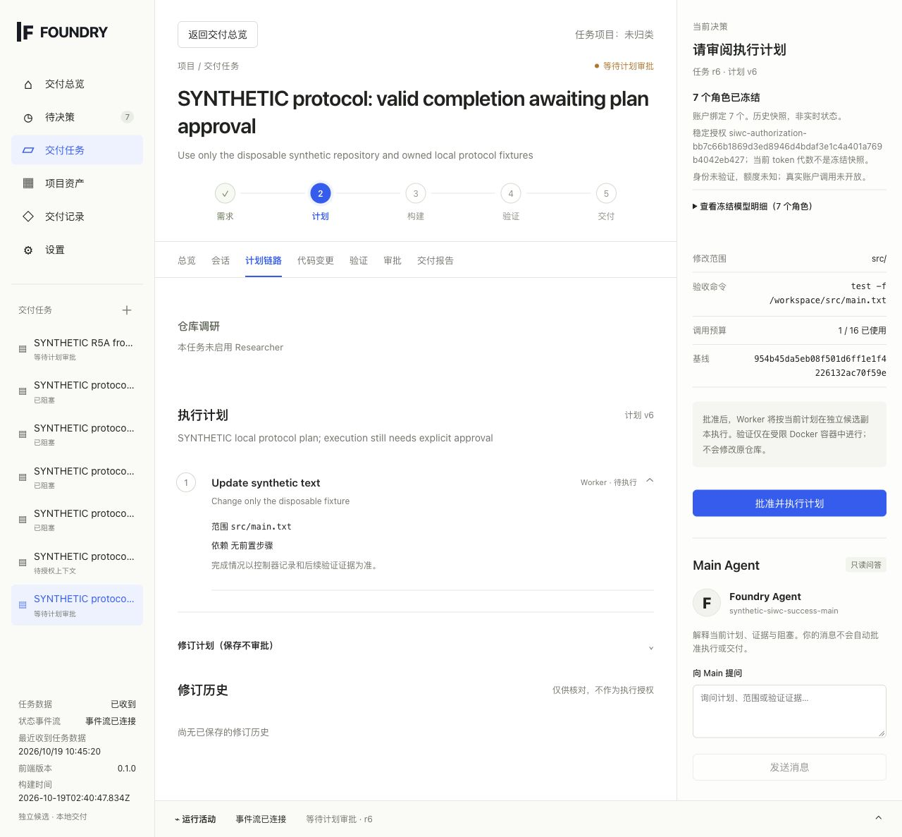
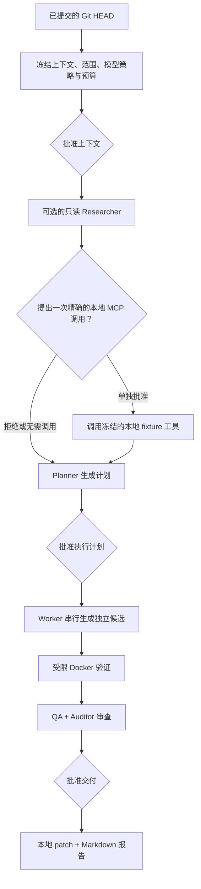
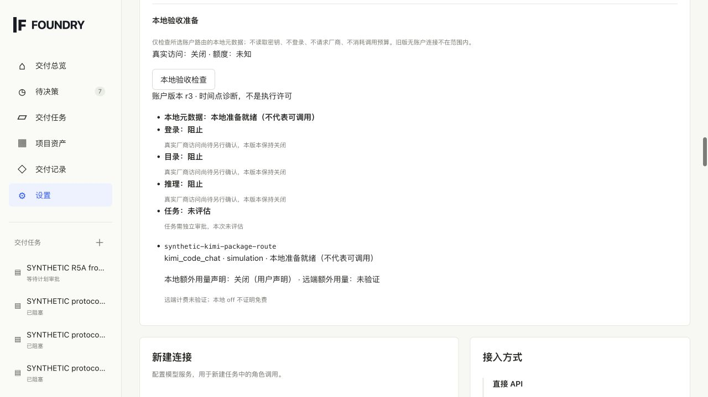

<div align="center">

# FOUNDRY

**把已提交的 Git 快照，变成可审、可验、可交付的本地补丁。**

实验性 · 本地优先 · macOS arm64 源代码 Alpha

[](https://github.com/tsumon/foundry/actions/workflows/verify.yml)
[](docs/public/alpha-status.md)
[](docs/public/alpha-status.md)
[](LICENSE)

[简体中文](README.md) · [English](README.en.md) · [开始使用](#quick-start) · [安全模型](docs/public/safety.md) · [架构](docs/public/architecture.md)

</div>

> [!CAUTION]
> 这是实验性的源代码 Alpha，不是安装包、二进制 Release 或生产服务。当前仅支持 Apple Silicon Mac，尚未用真实模型账户、订阅、额度、计费或外部 MCP 服务完成认证。请只使用无秘密的一次性仓库、全新的私有数据目录和合成模型配置。

<p align="center">
  
</p>

<p align="center"><sub>真实工作台界面，运行于一次性合成仓库、内存假凭据、本地协议 fixture 和 synthetic runner；此图不证明真实账户、云 provider、外部 MCP 或 Docker 执行。</sub></p>

FOUNDRY 是一个面向本地软件交付的工作台。它冻结已提交的 Git 快照，把模型建议变成可检查的计划和独立候选，再把验证证据、QA/Auditor 审查与最终导出放在不同的批准门之后。

它不会把模型输出当作权限，也不会修改源仓库、自动应用 patch、提交、推送、部署或执行数据库迁移。最终产物只是供你再次人工检查的本地 patch 和 Markdown 报告。

## 你得到什么

| 先看清，再批准 | 原仓库保持只读 | 证据不足就停止 |
| --- | --- | --- |
| 上下文共享、一次 MCP 调用、计划执行和最终交付分别批准；每次批准绑定控制器计算的 revision 和 digest。 | FOUNDRY 读取固定 commit，把候选文件保存在控制器数据目录中；Worker 不运行主机 shell，也不直接写源仓库。 | 验证与 QA/Auditor 审查分离。远程结果未知时不会自动重试、替换 provider、退还预算或假装回滚成功。 |

<a id="quick-start"></a>

## 3 步安全启动

### 前置条件

- Apple Silicon Mac（`darwin/arm64`）、启用 cgo，并安装可用的 C 编译器。受支持的凭据后端是 macOS Keychain。
- Go 1.27.3、Node.js 22.23.2、npm 10.9.8，以及支持 `GIT_NO_LAZY_FETCH` 的系统 `/usr/bin/git`。`/usr/bin/git --no-lazy-fetch --version` 必须成功；在 `PATH` 中另装 Git 不能替代这个受信任路径。
- Docker 只在任务执行、验证或 Docker smoke test 时需要。daemon 必须已运行，且可信镜像必须已存在于本机；FOUNDRY 使用 `--pull=never`。

### 1. 安装锁定的前端依赖并构建

```sh
git clone https://github.com/tsumon/foundry.git
cd foundry
cd web
npm ci
cd ..
./scripts/build.sh
```

构建脚本运行 TypeScript/Vite 生产构建并生成 `./bin/foundry`。它不会安装 Go、Node.js、npm、Docker 或镜像。

### 2. 创建全新的私有数据目录

```sh
FOUNDRY_ALPHA_DATA="$(mktemp -d)"
chmod 700 "$FOUNDRY_ALPHA_DATA"
export FOUNDRY_DATA_DIR="$FOUNDRY_ALPHA_DATA"
```

不要把首次运行指向已有的 FOUNDRY 数据目录。启动时会取得目录独占锁，并可能对其中记录的工作执行本地恢复或清理。

### 3. 启动工作台

```sh
./bin/foundry
```

打开 <http://127.0.0.1:4317>。服务器只接受字面地址 `127.0.0.1:<port>`；不接受通配地址、`localhost` 或其他回环地址。这次空白启动不会创建模型 profile、读取 provider 凭据、启动模型 fixture、拉取 Docker 镜像或联系 provider。

<details>
<summary>启动排障</summary>

- **默认端口被占用：** 使用另一个字面回环端口，例如 `FOUNDRY_ADDR=127.0.0.1:4318 ./bin/foundry`，然后打开 <http://127.0.0.1:4318>。
- **构建预检失败：** 对照 `scripts/verify.sh` 检查精确工具版本、cgo/C 编译器，以及 `/usr/bin/git --no-lazy-fetch --version`。`scripts/build.sh` 不会安装缺失工具或前端依赖。
- **数据目录已被占用：** 停止拥有该目录的另一个 FOUNDRY 进程，或创建新的临时目录。不要强制删除锁、数据库、工作区或密封证据来绕过状态检查。

</details>

## 工作流与 Alpha 边界



批准上下文不等于批准工具调用或执行；一次 MCP 授权不允许第二次调用；计划批准也不等于交付批准。角色是职责分工，不是权限来源；详细图和角色边界见[架构](docs/public/architecture.md)。

| 当前已实现 | 当前未实现 |
| --- | --- |
| Go 控制器、React 工作台、SQLite 状态和真实事件流 | 安装包、签名应用、包管理器分发或可下载二进制版本 |
| 每个任务内单 Worker、串行执行；可保存多个任务记录 | 多 Worker 调度或自主后台执行 |
| 已提交 Git 快照、受保护路径和控制器管理的候选代次 | 写入源仓库、自动 apply、commit、push、release 或 deploy |
| 受限仓库读取、静态 Skill 文本和 MCP 目录发现 | Skill/脚本执行、通用外部 MCP `tools/call`、webhook 或 Git hook |
| 已有 Docker 镜像中的无网络验收 | 自动拉取镜像、主机 shell 回退、构建安装包或运行数据库迁移 |
| 本地账户/路由元数据验收检查，真实接入保持关闭 | 真实账户、订阅、额度、计费、目录或推理认证 |
| QA/Auditor 审查后导出本地 patch 和报告 | 自动 provider/付费回退或未知远程结果重放 |

“当前未实现”不代表交付承诺。完整状态和验证范围见 [Alpha 状态](docs/public/alpha-status.md)。

## 合成验收工作台

构建前端后，可以启动一次性验收环境查看真实工作台状态，而不读取个人配置或联系真实 provider：

```sh
go run ./cmd/foundry-acceptance --web-dir web/dist
```

该命令创建全新的临时 Git 仓库和 SQLite 状态，使用内存假凭据、控制器拥有的字面 `127.0.0.1` 协议 fixture、随机非生产端口和 synthetic runner。它不是生产入口；runner 不运行 Docker，关闭进程后临时产物会保留供检查。

<p align="center">
  
</p>

<p align="center"><sub>只读本地元数据检查会显示阻塞阶段、路由配置与未知的远程状态。它不读取 Keychain 值、不联系 provider，也不授予登录、目录发现、推理或任务执行权限。</sub></p>

模型接入采用“先准备、后逐阶段批准”的设计。除只读本地元数据检查外，一次性验收环境现提供连接、目录和推理三道分别提案、批准并显式执行的本地合成模拟门禁；它们只访问进程拥有的 loopback fixture。真实登录、真实目录发现、真实推理和任务验收仍分别关闭。参阅[模型验收：准备，不是实时接入](docs/public/model-acceptance.md)。

独立的浏览器连接模拟现支持审批后手动执行、10 分钟人工登录时限、显式读取与取消，并保留单次尝试和故障恢复记录。它不开放真实登录或本机 Keychain 检查。参阅[连接审批接线与人工登录时限](docs/public/openai-connection-handoff.md)。

OpenAI 订阅连接的[操作员入口](docs/public/openai-operator-entry.md)已接线，但普通启动仍关闭。经单独确认后，操作员需显式绑定一个官方路由，并完成本进程新的专用 Keychain 测试项检查；工作台随后仍要求独立提案、审批、执行和手动打开登录页。公开实现验收使用本地模拟；连接模式不开放目录、推理、刷新、自动重试或收费 API 切换。

[独立目录查询门禁](docs/public/openai-catalog-gate.md)与连接审批分开：仅在专用操作员模式下，允许为当前有效订阅凭据准备一次固定 `GET /v1/models` 的材料，再单独批准和执行。普通启动仍关闭；凭据过期就停止，不刷新、不重试、不调用模型、不自动更改角色策略。本阶段验证仅使用本地模拟，目录返回不代表推理、额度或计费已验收。

[独立单次推理门禁](docs/public/openai-inference-gate.md)同样默认关闭。专用操作员模式只允许为有效连接和同凭据目录证据准备一次 `gpt-6.1-sol` 固定文本测试，并要求单独批准、显式执行；不能用于任务或其他模型。30 秒超时和 1 MiB 接收限制不是 Token 或金额上限。额度与远程计费保持未知，失败或过期就停止，不刷新、不重试、不切换收费 API。实现验证仅使用本地模拟，真实推理仍需另行确认。

<details>
<summary>本地开发与运行入口</summary>

| 入口 | 行为 |
| --- | --- |
| `./scripts/start.sh` | 重新构建前后端，然后启动 `./bin/foundry`。 |
| `./scripts/dev.sh` | 重新构建，监听前端变化并运行同一 Go 服务；Go 变更需要重启。 |
| `go run ./cmd/foundry-acceptance --web-dir web/dist` | 启动一次性合成验收环境；不验证真实账户、云 provider 或 Docker。 |

生产入口可以显式启动控制器拥有的合成 MCP 测试服务：

```sh
FOUNDRY_MCP_DATA="$(mktemp -d)"
FOUNDRY_DATA_DIR="$FOUNDRY_MCP_DATA" ./bin/foundry --local-mcp-test
```

该服务只暴露一个固定的只读测试工具，是当前 Alpha 唯一能在任务中执行 `tools/call` 的 MCP。它不提供模型 fixture 或模型 profile；规划仍需要单独配置模型并经过全部批准门禁。

</details>

<details>
<summary>运行设置</summary>

| 设置 | 默认值与行为 |
| --- | --- |
| `FOUNDRY_DATA_DIR` | 数据库、控制器锁、任务工作区和导出。默认位于操作系统用户配置目录下的 `foundry`；显式空值会被拒绝。 |
| `FOUNDRY_ADDR` | `127.0.0.1:4317`；只接受字面地址 `127.0.0.1` 和有效端口。 |
| `FOUNDRY_WEB_DIR` | 当 `web/dist` 存在时默认使用它；显式空值会关闭静态 UI 服务。 |
| `FOUNDRY_DOCKER` | Docker 可执行文件名或路径，默认 `docker`。 |
| `FOUNDRY_DISABLE_CONTROLLED_READ_CREATION` | 可选 Go 布尔值；`true` 阻止创建新的受控读取任务，但历史记录仍可读取。非法值会阻止启动。 |
| `FOUNDRY_GO` | `scripts/build.sh` 和 Makefile 使用的 Go 命令，默认 `go`。 |
| `--local-mcp-test` | 显式启动合成 MCP fixture，默认关闭。 |
| `--openai-subscription-route` + `--openai-keychain-journal` | 操作员成对使用，指定一个已有官方订阅路由和新的私有检查日志。会执行新的本机专用测试项检查；真实使用须另行确认，不能替代工作台单次连接审批。见[操作员入口](docs/public/openai-operator-entry.md)。 |
| `--openai-catalog-route` | 独立目录模式，与连接启动参数互斥。仅检查指定路由的本地元数据；准备/批准不读取令牌、不联网。一次真实 GET 仍须独立审批并显式执行。见[目录门禁](docs/public/openai-catalog-gate.md)。 |
| `--openai-inference-route` | 独立单次推理模式，与连接/目录参数互斥。默认关闭；启动、准备和审批只检查元数据。固定模型和文本的一次请求仍需独立审批、显式执行，不能自动刷新、重试或切换收费 API。见[推理门禁](docs/public/openai-inference-gate.md)。 |

</details>

## 本地仓库任务演示（无账号、仅模拟）

已安装文档要求的 Go 工具链、已有依赖缓存且 `web/dist` 已构建时，在源码根目录运行：

```sh
GOTOOLCHAIN=local GOPROXY=off GOSUMDB=off go run ./cmd/foundry-acceptance --repository-tasks-fixture --web-dir web/dist
```

打开输出的本机 URL。两个全新临时仓库分别演示嵌套路径标签格式化与有依赖的多文件价格修改（包含新文件）。基线准备不等于批准：依次明确批准并执行基线、批准上下文规划、审阅/修改计划、批准执行，检查失败→修复→独立复核后再批准导出。源仓库和其 Git 状态不变。

可加 `--repository-task-path /absolute/path/to/repository` 只读导入已有仓库的已提交 HEAD；未提交/未跟踪文件不参与任务，工作区描述符必须与提交一致。不检查工作区是否干净，不运行 Git 转换过滤器。任务由受保护的 `foundry.task.json` 提供提案和精确内容断言，**不是自主模型推理或真实 Go/Docker 测试**，也不启用账号、Keychain、MCP 或订阅。此模式与 `--c4-controls-fixture` 互斥。格式、限制和流程见[仓库任务说明](docs/public/repository-task-orchestration.md)。

历史上已完成经单独批准的、范围受限的 Double 项目 C4-C Docker 验收；当时角色仍为本地模拟。历史证据不授权本次演示或任何未来真实执行。

## 首次使用前的安全边界

- **不是完全离线。** 新账户 route 标记为 `live` 时会以 `live_provider_access_pending_confirmation` 关闭，但兼容的旧式无账户 profile 在获批的模型操作中仍可联系其 HTTPS provider；本地 provider 可使用字面回环 HTTP。显式批准的 MCP 目录发现也可以联系选定端点。
- **不要使用真实凭据评估 Alpha。** 本地验收检查与合成测试没有认证真实 API key、账户、订阅、entitlement、quota、billing、balance 或 reset time。生产凭据设计为保存在 macOS Keychain，而不是 SQLite、浏览器存储、日志、报告或 fixture。
- **Docker 隔离不是安全证明。** FOUNDRY 使用已有镜像、`--pull=never`、`--network=none`、只读候选挂载、非 root 用户和资源限制；这些限制不能证明镜像、Docker、主机内核、命令或候选代码安全。
- **使用一次性输入。** 不要通过代理或端口转发暴露本地服务。应用任何导出 patch 前，请在产品外再次人工审查。

## 文档

- [Alpha 状态](docs/public/alpha-status.md)：已实现、未实现、支持范围和发布准备状态
- [架构](docs/public/architecture.md)：组件、批准图、角色、不可变快照、失败与恢复
- [安全模型](docs/public/safety.md)：凭据、MCP、Docker 和 Alpha 使用规则
- [模型验收](docs/public/model-acceptance.md)：只读准备检查、未来阶段、计费证据和失败矩阵
- [贡献指南](CONTRIBUTING.md) · [变更记录](CHANGELOG.md) · [安全报告](SECURITY.md) · [Apache License 2.0](LICENSE)

发现安全问题时，请使用 [GitHub 私密漏洞报告](https://github.com/tsumon/foundry/security/advisories/new)，不要提交公开 issue。

---

Copyright © 2026 [tsumon](https://github.com/tsumon). 本项目源代码依据 [Apache License 2.0](LICENSE) 提供。
